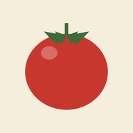

  

<h1 align="center">Nonna’s Kitchen</h1>

<i>Cucina di famiglia — les recettes de la famille, toutes au même endroit.</i>

  <a href="https://laureanneblt.github.io/NONNA-S-KITCHEN/"><b>Ouvrir l’app →</b></a>

---

Les lasagnes de mamie notées au dos d’une enveloppe, le tiramisù envoyé en photo floue sur WhatsApp, la sauce tomate que « tout le monde fait à l’œil »… Les recettes de famille finissent toujours éparpillées.

**Nonna’s Kitchen** les réunit dans un petit carnet partagé, qu’on garde dans sa poche. On y entre comme dans une trattoria : on pousse la porte verte, on s’installe sur la nappe à carreaux, et on cuisine.

## Ce qu’on peut y faire

- 📖 **Garder ses recettes** : un nom, une photo, les ingrédients, puis les étapes, une par ligne.
- 🍅 **Cuisiner avec son téléphone** : on coche les ingrédients au fur et à mesure, les étapes sont numérotées et faciles à suivre.
- 👨‍👩‍👧 **Partager en famille** : on crée une « famiglia », on envoie son code d’invitation, et chacun voit les recettes partagées avec elle.
- 🔒 **Garder ses secrets** : une recette peut rester privée, ou être partagée avec une ou plusieurs familles.
- 🔍 **Retrouver vite** : on cherche par nom de plat ou par ingrédient (« qu’est-ce que je fais avec ces courgettes ? »).

## L’installer sur son téléphone

Nonna’s Kitchen s’installe comme une vraie app, sans passer par un store :

- **iPhone** : ouvre le lien dans Safari, touche _Partager_ puis _Sur l’écran d’accueil_.
- **Android** : ouvre le lien dans Chrome, puis touche _Installer_.

## Le style

Une trattoria un peu vintage où l’on se sent bien : devanture verte, nappe à carreaux rouges, filets dorés et grandes lettres en italique, comme sur une vieille carte de menu. Même les emails d’inscription et de mot de passe oublié sont habillés pareil.

---

<b>Pour les curieux : comment c’est fait</b>

 

React, Vite et Tailwind v4 pour l’interface, Supabase pour les comptes, les données et les photos. L’app est hébergée sur GitHub Pages.

### Lancer en local

1. Crée un projet sur [supabase.com](https://supabase.com). Dans le _SQL Editor_, exécute `supabase/schema.sql`, puis les fichiers de `supabase/migrations/` dans l’ordre.
2. `cp .env.example .env`, puis renseigne l’URL et la clé anon (_Project Settings → API_).
3. `npm install && npm run dev`

### Déployer

Dans le repo GitHub : _Settings → Pages → Source : GitHub Actions_. Ajoute les secrets `VITE_SUPABASE_URL` et `VITE_SUPABASE_ANON_KEY`, puis pousse sur `main`.

Côté Supabase, dans _Authentication → URL Configuration_ :

- **Site URL** : l’URL GitHub Pages, sans `/` final.
- **Redirect URLs** : la même URL suivie de `/**`, et `http://localhost:5173/**` pour le développement.

### Emails

Les modèles aux couleurs de l’app sont dans `supabase/email-templates/`. Pour les utiliser, il faut d’abord brancher un SMTP (Gmail avec un mot de passe d’application suffit), puis les coller dans _Authentication → Emails → Templates_ :

| Modèle Supabase | Fichier               | Sujet                         |
| --------------- | --------------------- | ----------------------------- |
| Confirm signup  | `confirm-signup.html` | `Bienvenue à la tablée 🍅`    |
| Reset password  | `reset-password.html` | `Ton nouveau mot de passe 🍅` |

L’app attend un code à **6 chiffres** : dans _Authentication → Sign In / Providers → Email_, règle **Email OTP Length** sur `6` (Supabase met 8 par défaut sur les projets récents).

### Où trouver quoi

- `src/features/` : une fonctionnalité par dossier (`auth`, `recipes`, `groups`), avec ses pages et ses appels à Supabase.
- `src/components/` : les éléments communs (en-tête, barre d’onglets, tomate…).
- `src/index.css` : tout le design system. Les couleurs brutes (`tomato-500`…) d’abord, puis les noms utilisés par les composants (`bg-canvas`, `text-primary`, `border-line`…).
- `public/` : les icônes de l’app ; `vite.config.ts` : la configuration de l’installation sur téléphone.

<i>A tavola ! 🍝</i>

